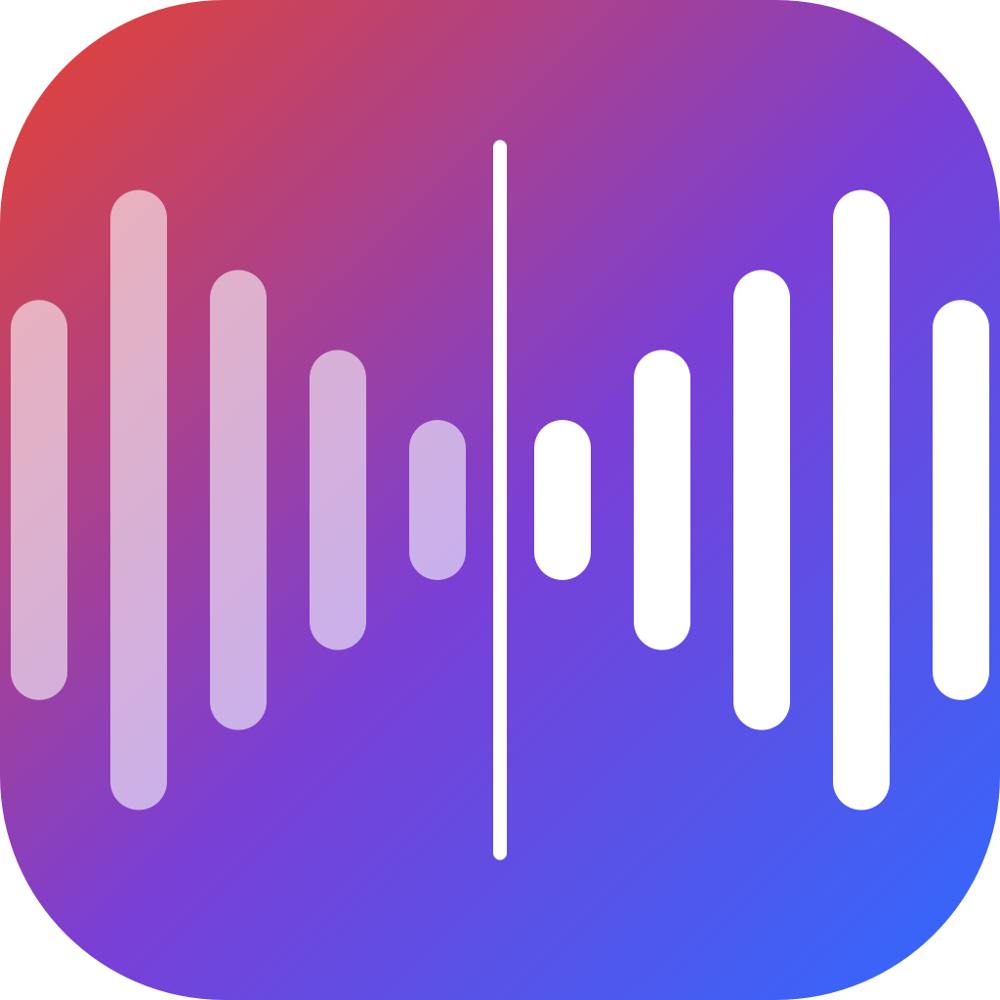

<p align="center"><a href="README.md">简体中文</a> | <b>English</b></p>

<p align="center"></p>

<h1 align="center">MirrorVoice 镜声</h1>

<p align="center"><a href="https://github.com/bard1124/mirrorvoice/releases/latest"></a>  </p>

<p align="center">
<b>Local real-time interpretation: you speak Chinese, the other side of the call hears English in <i>your own voice</i>; they speak English, you read Chinese subtitles.</b><br>
Runs entirely on your machine · works offline · no API keys · macOS (Apple Silicon) / Windows
</p>

---

## Features

| | |
|---|---|
| 🎙️ **Your voice, another language** | Record a 12-second sample; Qwen3-TTS zero-shot cloning speaks the translation in your voice into Teams / Zoom / Meet / Tencent Meeting |
| 💬 **Live subtitles for the other side** | Their speech is recognised and translated into an always-on-top, draggable subtitle bar (visible over full-screen meetings) |
| ⚡ **Low latency** | About 1.5 s from the end of your sentence until they hear it (measured on an M1 Pro); your speech always jumps ahead of subtitle work. Every sentence shows how long recognition / translation / speech took, and the slowest stage is pointed out |
| 🔒 **Fully local** | SenseVoice ASR, Qwen3 translation and Qwen3-TTS run on-device; after the first model download no network is needed |
| 📖 **Glossary & meeting background** | Fixed translations for product names, people and jargon, applied in both directions; list common mis-hearings (e.g. 万佛马 → OneForma) to fix them before translating; a one-line meeting background helps pick the right terminology |
| 🩺 **One-click routing check** | Without a meeting, checks that the other side can hear your translation, that their subtitles work, and your microphone and monitor, with fixes; step-by-step setup for Teams / Zoom / Tencent Meeting / Feishu |
| 🎧 **Device guard rails** | Every audio device is labelled with what it is for and the recommended one; combinations that echo or that the other side cannot hear are flagged; on macOS the meeting speaker follows new headphones in one click |
| 📝 **Meeting transcripts** | Every session is saved as a bilingual Markdown file + CSV |
| 🎛️ **Push-to-talk / mute** | Global hotkeys: hold Right Option/Alt to talk, or ⌃⌥M (Ctrl+Alt+M) to mute |
| 🔁 **Passthrough** | When you already speak their language, your real voice is sent untranslated |
| 🌏 **Languages** | Chinese / English / Japanese / Korean in any direction (Cantonese as input) |
| 🪟 **Floating windows & tray** | Two-way conversation window (both sides' original + translation, always on top, drag / resize), pinnable subtitle bar; tray / menu-bar icon and macOS Dock menu with Start/Stop, Pause/Resume, Quit |
| 🖥️ **Two front ends** | Graphical control panel (default) or a terminal-style view with coloured logs (type `m` mute / `u` update / `q` quit / `ui` switch back) |
| 🧭 **First-run wizard** | Downloads models (ModelScope or HuggingFace, whichever is faster; big files over several connections; resumable), installs the virtual audio cable, records your voice, explains the meeting-app setup |
| 🔄 **One-click update** | Checks GitHub for a newer release on startup (skipped offline); downloads, verifies SHA256, swaps in place and relaunches; models and settings are kept. In terminal mode type `u` |

## Install

Download from [Releases](../../releases):

- **macOS (Apple Silicon, macOS 14+)**: `MirrorVoice-x.y.z-macos-arm64.dmg`, drag to Applications. The app is not notarized: the first time, right-click → Open.
- **Windows 10/11 x64**: `MirrorVoice-x.y.z-windows-x64-setup.exe`. Not code-signed: on the SmartScreen prompt choose "More info → Run anyway".

The setup wizard starts on first launch. Models are about 4.5 GB (about 8 GB in high-quality mode).

### Platform support

| | macOS Apple Silicon | Windows + NVIDIA RTX 30 series or newer | Windows otherwise (no NVIDIA, or RTX 20 / GTX 16) |
|---|---|---|---|
| Recognition / subtitles | ✅ | ✅ | ✅ |
| Translation | MLX (Qwen3) | llama.cpp Vulkan/CUDA | llama.cpp CPU/Vulkan |
| Spoken translation | ✅ your cloned voice | ✅ your cloned voice (install the ~3 GB GPU voice pack from the wizard) | ✅ your cloned voice (Pocket TTS, real-time on CPU, English output only, record the sample in English); or the standard Kokoro voice |
| Virtual microphone | BlackHole 2ch (bundled) | VB-CABLE (downloaded by the wizard) | VB-CABLE |
| Other side's audio | BlackHole 16ch + Multi-Output device (created by the wizard) | speaker loopback (no setup) | speaker loopback |

The GPU voice pack needs native bf16 (compute capability ≥ 8.0, i.e. RTX 30 series or newer). RTX 20 / GTX 16 only emulate bf16 (an RTX 2060 took 10 s to synthesize 3 s of speech) and fp16 overflows, so those GPUs are treated like "no NVIDIA"; you can still force the GPU voice in the main window.

### Memory

With everything on (translation + cloned voice + subtitles) it uses about **5 GB** of RAM (measured on an M1 Pro); the Windows CPU path is similar. **16 GB machines run it smoothly** (use the "fast" models; "quality" needs about 3 GB more). Older CPUs translate a little slower (1–3 s per sentence).

8 GB machines or older computers can pick the "turbo" tier (Qwen3-1.7B): about twice as fast (0.36 s per sentence vs 0.78 s for "fast" on an M1 Pro), but noticeably lower translation quality.

### Company networks / certificate errors

Model downloads and update checks use the app's bundled CA store first and fall back to the system store (macOS Keychain / Windows certificate store) when verification fails. On networks that inspect HTTPS, downloads work as long as the company root certificate is installed in the system (if your browser opens GitHub and ModelScope, it is). To troubleshoot, set `MIRRORVOICE_TLS=certifi|system|default` to force a single store; `MIRRORVOICE_MODEL_SOURCE=modelscope|huggingface` pins the model download source.

## Meeting app setup

| | Microphone | Speaker |
|---|---|---|
| macOS | BlackHole 2ch | Teams 扬声器 (耳机+字幕) — the headphones + BlackHole 16ch Multi-Output device |
| Windows | CABLE Output (VB-Audio Virtual Cable) | your headphones |

Use headphones so the spoken translation is not picked up by your microphone again, and turn the meeting app's noise suppression down or off. 会议软件设置 in the control panel's device card has step-by-step instructions for Teams / Zoom / Tencent Meeting / Feishu, and 测试链路 checks the whole routing before a meeting.

## How it works

```
your mic      → Silero VAD → SenseVoice ASR → Qwen3 translation → Qwen3-TTS (your voice) → virtual mic → meeting app
meeting audio → loopback / BlackHole 16ch → SenseVoice ASR → Qwen3 translation → subtitle overlay
```

A single model thread owns every MLX/LLM/TTS object; your speech (priority 0) always goes ahead of subtitles (priority 1).

## Run from source

```bash
# macOS (Apple Silicon)
python3.12 -m venv .venv && .venv/bin/pip install -r requirements-mac.txt
.venv/bin/python -m mirrorvoice            # control panel
.venv/bin/python -m mirrorvoice cli        # terminal-style view
.venv/bin/python -m mirrorvoice download   # download models only
```

Tests: `.venv/bin/pip install -r requirements-dev.txt && .venv/bin/python -m pytest -q tests` (CI runs them on macOS and Windows; a failure blocks the release). Manual Windows checklist: [docs/windows-test-checklist.md](docs/windows-test-checklist.md).

Packaging: macOS `bash packaging/mac/build_dmg.sh`; Windows is built by GitHub Actions (`.github/workflows/build.yml`; pushing a `v*` tag publishes a Release).

Data folder: macOS `~/Library/Application Support/MirrorVoice`, Windows `%LOCALAPPDATA%\MirrorVoice` (models, voice sample, transcripts, glossary, settings, logs).

## Credits

Feature ideas from [LiveTranslate](https://github.com/NBS282/LiveTranslate) (push-to-talk, passthrough, setup wizard), [My Translator](https://github.com/phuc-nt/my-translator) (two-way translation, glossary, transcripts) and [LiveCaptions-Translator](https://github.com/SakiRinn/LiveCaptions-Translator) (subtitle styling, history export). Model and component licenses: [THIRD_PARTY_NOTICES.md](THIRD_PARTY_NOTICES.md).

## Responsible use

Only clone your own voice, or a voice whose owner has consented. Let other participants know you are using live translation.

## License

[MIT](LICENSE)
