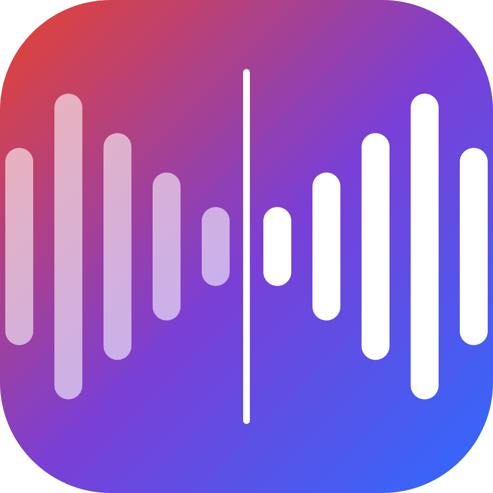

<p align="center"><b>简体中文</b> | <a href="README.en.md">English</a></p>

<p align="center"></p>

<h1 align="center">同传助手 TongChuan</h1>

<p align="center">
<b>本地实时同声传译：你说中文，会议对方听到用你自己声音说的英文；对方说英文，你看到中文字幕。</b><br>
全部在本机运行 · 不联网 · 不需要 API Key · macOS (Apple Silicon) / Windows
</p>

---

## 功能

| | |
|---|---|
| 🎙️ **你的声音说外语** | 录 12 秒样本，用 Qwen3-TTS 零样本克隆你的音色，把译文用"你的声音"送进 Teams / Zoom / Meet / 腾讯会议 |
| 💬 **对方说话出字幕** | 会议里对方的声音实时识别并翻译，屏幕底部悬浮字幕条（置顶、可拖动、全屏会议上方也可见） |
| ⚡ **低延迟** | 说完一句约 1.5 秒对方听到（M1 Pro 实测）；你的发言优先于字幕处理 |
| 🔒 **完全本地** | 识别 SenseVoice、翻译 Qwen3、合成 Qwen3-TTS 都在本机；模型下载后可断网使用 |
| 📖 **术语表** | 产品名、人名、专业词固定译法，双向生效 |
| 📝 **会议记录** | 每场会议自动保存中英对照 Markdown + CSV |
| 🎛️ **按住说话 / 一键静音** | 全局快捷键：按住右 Option/Alt 才翻译，或 ⌃⌥M 静音 |
| 🔁 **原声透传** | 你直接说对方的语言时，不翻译、把你的原声送过去 |
| 🌏 **多语言** | 中文 / 英语 / 日语 / 韩语（粤语可作为输入）任意组合 |
| 🖥️ **两种界面** | 图形控制面板（默认）或命令行风格（彩色日志，输入 `m` 静音 / `q` 退出 / `ui` 切回） |
| 🧭 **首次向导** | 自动下载模型（ModelScope/GitHub，断点续传）、安装虚拟声卡、录音色、会议软件设置 |

## 安装

从 [Releases](../../releases) 下载：

- **macOS（Apple Silicon，macOS 14+）**：`TongChuan-x.y.z-macos-arm64.dmg`，拖进「应用程序」。未经 Apple 公证，首次请右键 →「打开」。
- **Windows 10/11 x64**：`TongChuan-x.y.z-windows-x64-setup.exe`。未签名，SmartScreen 提示时点「更多信息 → 仍要运行」。

首次打开会进入设置向导，模型约 4.5 GB（高质量模式约 8 GB）。

### 各平台能力

| | macOS Apple Silicon | Windows + NVIDIA 显卡 | Windows 无 NVIDIA |
|---|---|---|---|
| 识别 / 字幕 | ✅ | ✅ | ✅ |
| 翻译 | MLX (Qwen3) | llama.cpp Vulkan/CUDA | llama.cpp CPU/Vulkan |
| 说出译文 | ✅ 你的克隆音色 | ✅ 你的克隆音色（向导里装 GPU 音色包，约 3 GB） | ✅ 标准英文音色（Kokoro，不是你的声音） |
| 虚拟麦克风 | BlackHole 2ch（安装包内置） | VB-CABLE（向导里下载） | VB-CABLE |
| 对方声音来源 | BlackHole 16ch + 多输出设备（向导自动创建） | 扬声器回采（无需设置） | 扬声器回采 |

## 会议软件设置

| | 麦克风 | 扬声器 |
|---|---|---|
| macOS | BlackHole 2ch | Teams 扬声器 (耳机+字幕) |
| Windows | CABLE Output (VB-Audio Virtual Cable) | 你的耳机 |

请使用耳机，避免翻译语音被麦克风再次收进去。

## 工作原理

```
你的麦克风 → Silero VAD 断句 → SenseVoice 识别 → Qwen3 翻译 → Qwen3-TTS 你的音色 → 虚拟麦克风 → 会议软件
会议扬声器 → 回采 / BlackHole 16ch → SenseVoice 识别 → Qwen3 翻译 → 悬浮字幕
```

一个模型线程独占所有 MLX/LLM/TTS 对象，你的发言（优先级 0）总是插队到字幕（优先级 1）前面。

## 从源码运行

```bash
# macOS (Apple Silicon)
python3.12 -m venv .venv && .venv/bin/pip install -r requirements-mac.txt
.venv/bin/python -m tongchuan            # 图形界面
.venv/bin/python -m tongchuan cli        # 命令行风格
.venv/bin/python -m tongchuan download   # 只下载模型
```

打包：macOS `bash packaging/mac/build_dmg.sh`；Windows 由 GitHub Actions 构建（`.github/workflows/build.yml`，推送 `v*` 标签自动发布 Release）。

数据目录：macOS `~/Library/Application Support/TongChuan`，Windows `%LOCALAPPDATA%\TongChuan`（模型、音色样本、会议记录、术语表、设置、日志）。

## 参考与致谢

功能设计参考了 [LiveTranslate](https://github.com/NBS282/LiveTranslate)（按住说话、原声透传、首次向导）、[My Translator](https://github.com/phuc-nt/my-translator)（双向翻译、术语表、会话记录）、[LiveCaptions-Translator](https://github.com/SakiRinn/LiveCaptions-Translator)（字幕样式、历史导出）。模型与组件许可见 [THIRD_PARTY_NOTICES.md](THIRD_PARTY_NOTICES.md)。

## 负责任使用

音色克隆只用于你自己的声音，或已获得本人同意的声音。在会议中使用前，请告知参会者你在使用实时翻译。

## License

[MIT](LICENSE)
